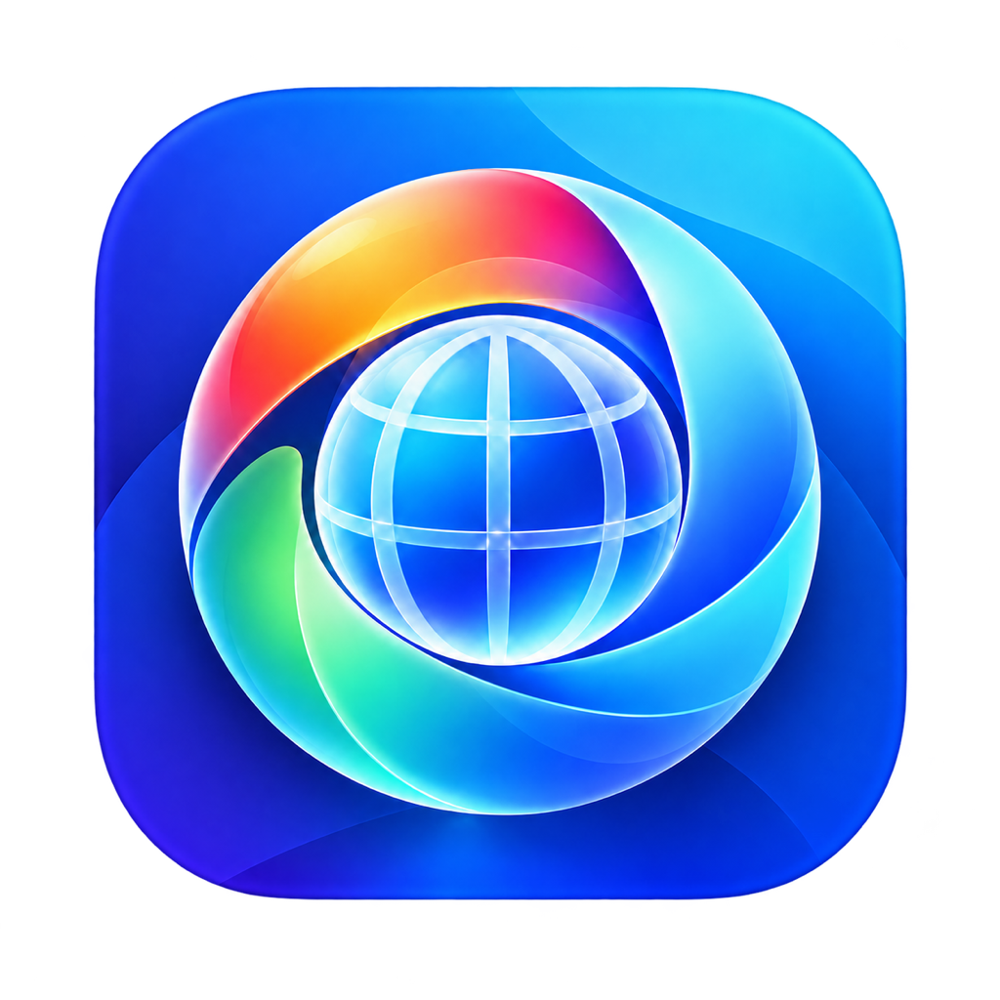

# WebDock

**One Dock icon for your websites, browsers and accounts.**

**English** · [简体中文](README.md) · [Download 1.1.0](https://github.com/CodeAIX/WebDock/releases/latest)

WebDock is a native macOS website launcher. Search, organize and open websites from Launcher, choose a browser and a supported browser account for each site, and carry the same launch rules between Macs through backup or synchronization.

Requires **macOS 13.0 or later**. The universal application supports **Intel and Apple Silicon**.

## Download and install

Download from [GitHub Releases](https://github.com/CodeAIX/WebDock/releases/latest):

| File | Purpose |
| --- | --- |
| `WebDock-1.1.0-macos-universal.dmg` | Open and drag WebDock to Applications |
| `WebDock-1.1.0-macos-universal.zip` | Extract and move WebDock.app to Applications |
| `WebDock.icns` | Standalone application icon |
| `SHA256SUMS.txt` | SHA-256 checksums for the downloads |

Packages are ad-hoc signed and are not Developer ID signed or Apple notarized. If macOS blocks the first launch, verify the download source and follow [Apple’s guidance for opening apps](https://support.apple.com/en-us/102445).

To update, quit WebDock and replace the application in Applications. Your library is stored in your user Application Support folder. You can create a backup in Settings → Backup & Restore before updating.

## Get started

1. Open WebDock, click `+` in Launcher and enter a name and an HTTP/HTTPS website address.
2. Optionally choose a browser and, for browsers that support account routing, an account email.
3. Click a website icon to open it. Find sites with search, the group sidebar or keyboard navigation.
4. Use the bookmark button to open Library and edit launch rules, groups, icons and this Mac’s browser overrides.

## Launcher and Library

- One Dock entry; click its Dock icon to show or hide Launcher.
- Search websites and groups, navigate with arrow keys and launch with Return.
- Drag to reorder in the unfiltered All Shortcuts view; ordering survives restart.
- Create, edit, duplicate and delete website rules, with protection for unsaved drafts.
- Automatically discover website icons or choose local images, with browser badges and resolution warnings.

## Global shortcut

While WebDock is running, press **⌃⌥W (Control + Option + W)** to open Launcher from another application.

Settings → General → Global Shortcut lets you enable, disable, record a new combination or restore the default. Your choice stays on this Mac and survives restart. Registration conflicts display a message and preserve the previous choice. Press Escape to cancel recording.

| Shortcut | Action |
| --- | --- |
| `⌃⌥W` | Open Launcher globally; customizable |
| `⌘1` | Open Launcher within WebDock |
| `⌘2` | Open Library |
| `⌘N` | New shortcut |
| `⌘F` | Search in Launcher |
| `⌘,` | Open Settings |

## Browsers and accounts

Use the system default browser or choose Safari, Chrome, Chromium, Edge, Firefox, Brave, Arc or Vivaldi.

Chrome, Chromium, Edge, Brave and Vivaldi support matching locally signed-in accounts by email. The same email can resolve to different local profile directories on different Macs.

- A missing account falls back to the chosen browser’s default profile with a warning.
- A missing browser falls back to the system default browser with a warning.
- If account matching is ambiguous, choose a local override in Library’s This Mac area. It does not affect other Macs.

macOS may require permission to read browser profile metadata. Use Authorize / Rescan in Settings → Browsers & Accounts, then follow the system’s Files & Folders permission prompts. WebDock cannot enable system permissions on your behalf.

## Backup and restore

- Automatic local snapshots: at most one per day, retaining the newest 20 automatic snapshots.
- Manual backups and portable `.webdockbackup` exports.
- Replace or merge restore, with a safety snapshot created first.
- Portable backups include websites, browser preferences, account emails, groups, ordering and website icons. Local browser paths, profile directories and device overrides are excluded.

## Sync between Macs

Choose one method in Settings → Sync:

| Method | Setup |
| --- | --- |
| Synced Folder | Choose an ordinary folder managed by iCloud Drive, Dropbox, OneDrive, Syncthing, a NAS or another file-sync tool |
| WebDAV | Enter an existing folder URL, username and password/app password, save credentials, test the connection and sync |

Both methods exchange `WebDockSync.json`. Website rules, groups, ordering and website icons sync. Local browser resolution, overrides, appearance preferences, the global shortcut and custom app icons stay on each Mac. WebDAV passwords are stored in macOS Keychain.

## Language and appearance

- Simplified Chinese and English, following the system by default or manually selected in General Settings.
- App content updates immediately; restart for macOS menus and system dialogs to fully adopt the selected language.
- System, light and dark appearance; configurable grid density, subtitles, sidebar and badges.
- Globe and colorful orbital ribbon artwork as the default app icon.
- Choose a local ICNS in Appearance to customize the running Dock / ⌘Tab icon, or restore the default. Finder keeps the installed application’s default icon.

## Privacy and data

WebDock reads only browser profile metadata needed to match accounts. It does not read cookies, passwords, browsing history or page content. Automatic website icons request public icon information from the corresponding website without browser cookies or credentials.

Your library is stored in `~/Library/Application Support/WebDock/`. Portable backups and sync data may contain website addresses, account emails and website icons you configure. Choose trusted storage locations and sync services. Use HTTPS for remote WebDAV connections.

## FAQ

**The global shortcut does nothing.** Confirm WebDock is running, check the switch and any registration error in General Settings, and record a different combination if needed.

**Browser accounts are missing after an update.** Keep one WebDock copy in Applications, quit other copies, and retry Authorize / Rescan. Different ad-hoc signed builds may require authorization again; macOS manages these permissions.

**Can I import browser shortcut files?** Create a website rule directly. Importing `.crwebloc`, `.webloc` and `.url` files is not supported.

**Does synchronization copy browser sign-ins?** No. Install browsers and sign in separately on each Mac. WebDock synchronizes launch rules only.

## More information

[Build and validate](docs/BUILDING.md) · [Sync and data structure](docs/SYNC_AND_DEVICE_RESOLUTION.md) · [Limitations](docs/KNOWN_LIMITATIONS.md) · [Report a problem](https://github.com/CodeAIX/WebDock/issues)
